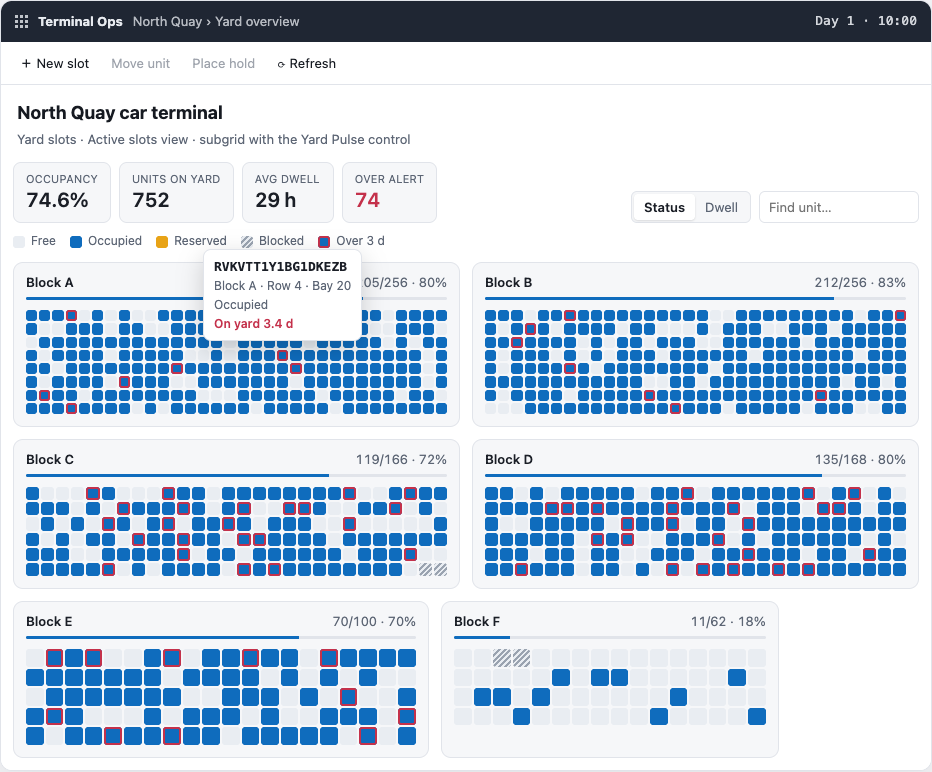

# Yard Pulse

**A Power Apps code component (PCF) that draws a whole yard as one live heatmap.**

Point it at any Dataverse view of yard slots (car terminal, container yard, warehouse floor, parking) and every block appears as a grid. Slots that change between refreshes pulse. Units past the dwell limit get a red ring. Double-click a slot to open the record.

**[▶ Live demo](https://phlppgdfry.github.io/pcf-yard-pulse/)** runs the real control on a simulated car terminal. No Dataverse needed.

<picture>
  <source media="(prefers-color-scheme: dark)" srcset="docs/yard-pulse-dark.png">
  
</picture>

## What it does

| | |
|---|---|
| **Whole yard in one view** | One grid per block, sized from the highest row and bay in the data. Gaps stay visible as empty positions. |
| **Live KPIs** | Occupancy (excluding blocked slots), units on the yard, average dwell and the number of units over the alert. Each block shows its own fill bar. |
| **Pulse on change** | The control keeps a snapshot of every slot. On a refresh, slots whose status, unit or overdue flag changed animate. Dwell ticking up does not trigger a pulse. |
| **Two colour modes** | *Status* (free, occupied, reserved, blocked) or *Dwell* (four steps up to the alert, then red). The maker picks the default and viewers can switch. |
| **Find a unit** | Type part of a VIN or container number. Matches are outlined and everything else fades. |
| **Native behaviour** | Click selects, Ctrl/Cmd-click adds to the selection, double-click or Enter opens the form. The selection feeds the subgrid's command bar. |
| **Accessible** | ARIA grid with one tab stop per block, arrow and Home/End keys, a full spoken label per slot, a live region for changes, and support for `prefers-reduced-motion`. |
| **Light and dark** | Every colour is a CSS token, scoped under `.yp`. |

## Install in your environment

Download `YardPulse_managed.zip` from the [latest release](https://github.com/phlppgdfry/pcf-yard-pulse/releases/latest), then:

```bash
pac auth create --environment https://yourorg.crm4.dynamics.com
pac solution import --path YardPulse_managed.zip
```

Then add the **Yard Pulse** control to a subgrid or a view of your slot table and bind the columns:

| Property set | Required | Accepted column types | Notes |
|---|---|---|---|
| `block` | yes | Text, Choice, Lookup | Block or zone name. Blocks sort naturally (B2 before B10). |
| `row` | yes | Whole number, Decimal, Float | 1-based. |
| `bay` | yes | Whole number, Decimal, Float | 1-based. |
| `status` | yes | Text, Choice, Lookup | See the mapping below. |
| `dwellHours` | no | Whole number, Decimal, Float | Only counts for occupied slots. |
| `unit` | no | Text, Choice, Lookup | VIN, container number and so on. Used by search and the tooltip. |

| Control property | Default | |
|---|---|---|
| `colorBy` | `status` | `status` or `dwell` |
| `dwellAlertHours` | `72` | Units at or above this many hours count as overdue. |

**Status mapping** works on the label, in English and Dutch: *Free / Empty / Available / Vrij / Leeg* → free; *Reserved / Booked / Planned / Gereserveerd / Gepland* → reserved; *Blocked / Hold / Closed / Damaged / Geblokkeerd / Defect* → blocked. Any other label counts as occupied.

The control asks for a single page of up to 5,000 records. If the view returns more, a notice says so. Records with no position, or a second record on an already-taken position, are counted and reported, never dropped silently.

## How it is built

```
Dataverse view ─▶ dataset + property-sets ─▶ readSlots() ─▶ buildYard() ─▶ YardView
                  (PCF runtime)              core/dataset    core/model     core/view
```

```
YardPulse/
  ControlManifest.Input.xml   dataset, property-sets, maker properties
  index.ts                    thin PCF adapter: paging, open, selection
  core/model.ts               pure: status mapping, KPIs, diffing, dwell buckets
  core/view.ts                DOM renderer: patches cells in place so they can pulse
  core/dataset.ts             dataset → RawSlot[] through the property-set aliases
  css/YardPulse.css
demo/                         mock PCF host + seeded terminal simulator → GitHub Pages
test/                         Vitest: model in Node, the full control in jsdom
solution/                     Dataverse solution (pac solution init), builds both zips
samples/                      CSV for the pac test harness
```

The model and the view never touch `ComponentFramework`. As a result:

- the **tests** check the real control end to end in jsdom (rendering, selection, open, keyboard, pulse diffing) through `demo/mock-context.ts`;
- the **demo** runs the same `YardPulse` class you import into Dataverse, not a lookalike;
- `index.ts` stays about 70 lines.

## Develop

Needs Node 20+ and the .NET SDK. Install the Power Platform CLI as a .NET tool:

```bash
dotnet tool install --global Microsoft.PowerApps.CLI.Tool
```

```bash
npm ci
npm run build                 # pcf-scripts: validate manifest, lint, bundle
npm test                      # 31 tests
npm run demo                  # demo site on http://localhost:5173
npm start                     # pac test harness; load samples/north-quay-slots.csv
dotnet build solution/YardPulseSolution.cdsproj -c Release
```

For a quick push to a dev environment without a solution: `pac pcf push --publisher-prefix phg`.

## CI/CD

GitHub Actions runs on every push and pull request:

1. `pcf-scripts` production build (manifest validation and ESLint included)
2. lint, typecheck and tests
3. the demo bundle
4. `dotnet build` of the solution, plus a check that the managed zip contains the control

On `main` the demo deploys to GitHub Pages. Pushing a `v*` tag publishes a release with the managed and unmanaged zips attached.

## License

MIT. North Quay, its vessels and its VINs are fictional.
